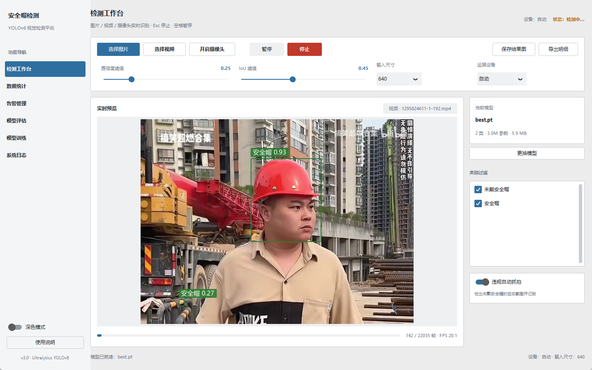
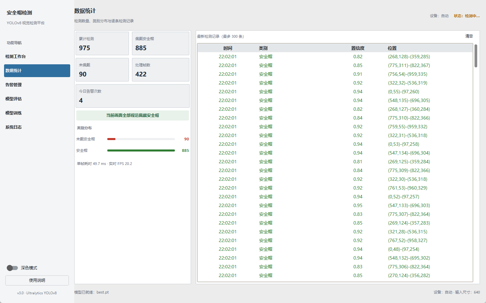
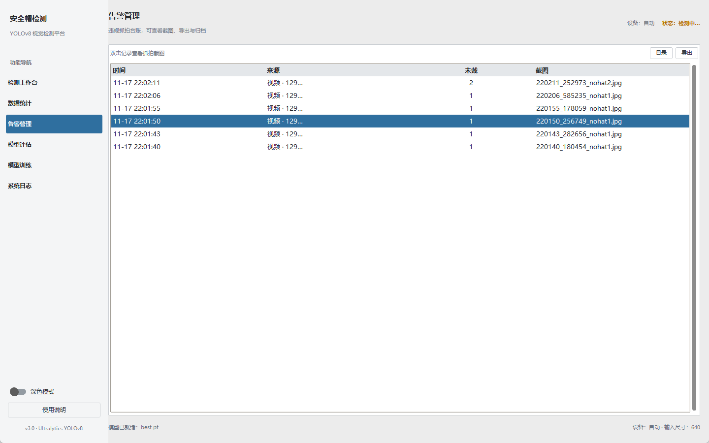
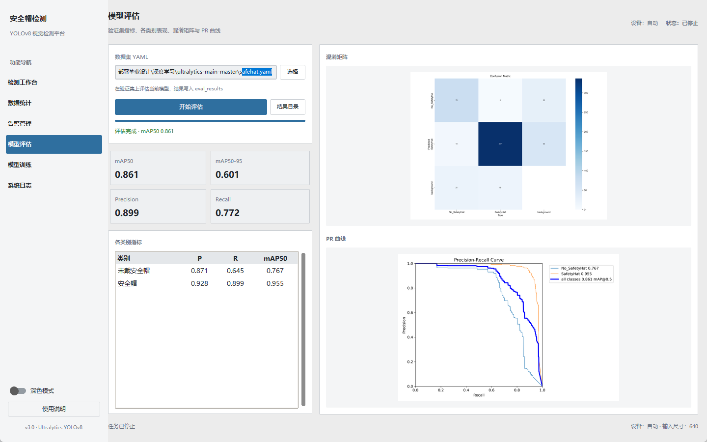
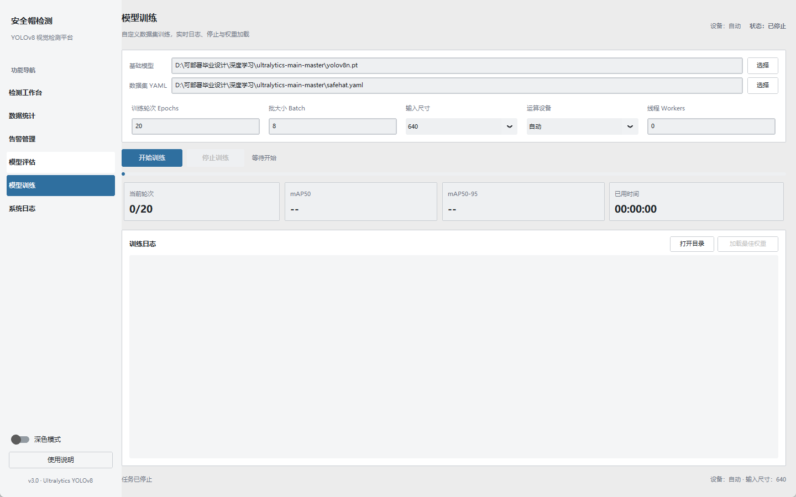
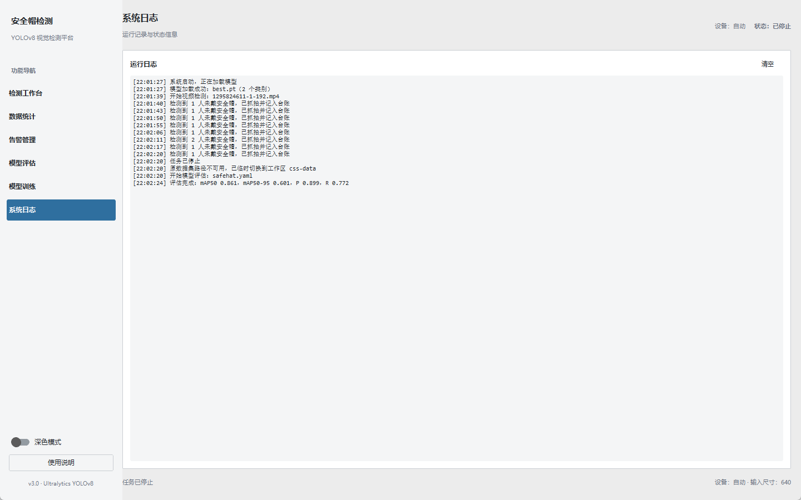

# 安全帽佩戴检测系统
# 源码获取： https://mbd.pub/o/bread/YZaWl55raw==

基于 **YOLOv8 + CustomTkinter** 的桌面端安全帽检测平台，面向工地、厂区等场景，提供从数据训练、模型评估到实时检测、违规抓拍的完整闭环。


---

## 界面预览

| 检测工作台 | 数据统计 |
| --- | --- |
|  |  |

| 告警管理 | 模型评估 |
| --- | --- |
|  |  |

| 模型训练 | 系统日志 |
| --- | --- |
|  |  |

---

## 功能特性

### 检测工作台
- 支持 **图片 / 视频 / 摄像头** 三种检测源，检测任务在后台线程执行，界面不卡顿
- 实时调节 **置信度阈值、IoU 阈值、输入尺寸（640 / 1280）、运算设备（CPU / CUDA）**
- 检测类别过滤、暂停 / 继续、停止、进度条与 FPS 显示
- 检测结果图保存，逐条检测明细导出 CSV
- 中文标签渲染，兼容中文路径读写

### 数据统计
- 累计检测数、佩戴 / 未佩戴数量、处理帧数、今日告警次数统计卡片
- 类别分布条形图，最近 300 条检测记录表格（时间、类别、置信度、坐标）
- 单帧耗时与实时 FPS 显示

### 告警管理（违规自动抓拍）
- 检出未戴安全帽时自动保存带框截图至 `alerts/日期/` 目录
- 使用 **SQLite（alerts.db）** 持久化告警台账，记录时间、来源、违规人数、截图路径
- 同一会话 3 秒内只抓拍一次，避免重复记录
- 支持双击查看截图、打开告警目录、导出台账 CSV
- 可在检测工作台右侧开关中随时关闭

### 模型评估
- 选择数据集 YAML 后一键在验证集上评估
- 展示 **mAP50、mAP50-95、Precision、Recall** 及各类别指标
- 自动加载并显示 **混淆矩阵** 与 **PR 曲线**，结果写入 `eval_results/`
- 当 YAML 中的绝对路径失效时，自动回退到工作区 `css-data`，无需手动改配置

### 模型训练
- 可视化配置基础模型、数据集、训练轮次、批大小、输入尺寸、运算设备、线程数
- 训练以独立后台进程运行，日志实时输出，支持中途停止
- 实时同步当前轮次、mAP50、已用时间，可从 `results.csv` 读取指标
- 训练完成后一键加载最佳权重（best.pt）回到检测工作台

### 其他
- 深色 / 浅色主题切换
- 六大页面独立运行，页面切换时检测任务继续执行
- 使用说明弹窗、状态栏、操作日志

---

## 模型指标

在 `css-data` 验证集（100 张）上的评估结果（`best.pt`，2 类，约 3.0M 参数，5.9 MB）：

| 指标 | 数值 |
| --- | --- |
| mAP50 | **0.861** |
| mAP50-95 | **0.601** |
| Precision | **0.899** |
| Recall | **0.772** |

各类别表现：

| 类别 | P | R | mAP50 |
| --- | --- | --- | --- |
| 未戴安全帽（No_SafetyHat） | 0.871 | 0.645 | 0.767 |
| 安全帽（SafetyHat） | 0.928 | 0.899 | 0.955 |

> 训练配置：YOLOv8n，50 epochs，输入尺寸 640，CPU 环境下完成训练。

---

## 数据集

项目内置安全帽数据集 `css-data`（YOLO 格式）：

| 划分 | 图片数 | 说明 |
| --- | --- | --- |
| train | 2500 | 训练集 |
| valid | 100 | 验证集 |
| test | 100 | 测试集 |

```
css-data/
├── train/
│   ├── images/
│   └── labels/
├── valid/
│   ├── images/
│   └── labels/
└── test/
    ├── images/
    └── labels/
```

类别定义（[safehat.yaml](safehat.yaml)）：

```yaml
nc: 2
names: ['No_SafetyHat', 'SafetyHat']
```

---

## 快速开始

### 环境要求

- Python 3.9+（推荐 3.11）
- Windows 系统（摄像头调用、字体与目录打开逻辑基于 Windows）
- 可选：NVIDIA 显卡 + CUDA 环境，用于加速推理与训练

### 安装依赖

```bash
# 建议使用虚拟环境
python -m venv venv
venv\Scripts\activate

# 安装核心依赖
pip install ultralytics customtkinter opencv-python pillow pyyaml
```

> 如需 GPU 加速，请先按照 [PyTorch 官方指引](https://pytorch.org/get-started/locally/) 安装对应 CUDA 版本的 torch。

### 启动系统

```bash
python Main.py
```

启动后默认加载工作区内的 `best.pt`，可直接开始检测；也可在「检测工作台」右侧点击「更换模型」加载其他权重。

---

## 使用指南

### 基本流程

1. **选择图片**：单张图片检测，完成后可保存结果图
2. **选择视频**：逐帧检测，显示进度条与 FPS，支持暂停 / 继续
3. **开启摄像头**：实时检测，按 `Esc` 或点击「停止」结束
4. 在「数据统计」查看统计与明细，「告警管理」查看违规抓拍台账
5. 在「模型评估」验证模型指标，「模型训练」使用自定义数据集重新训练

### 参数说明

| 参数 | 说明 |
| --- | --- |
| 置信度阈值 | 越大越严格，漏检减少但误检可能增加 |
| IoU 阈值 | 控制重叠框合并强度 |
| 输入尺寸 | 640 速度最快，1280 适合小目标 |
| 运算设备 | 有 NVIDIA 显卡时可切换至 CUDA:0 加速 |

### 快捷键

| 按键 | 功能 |
| --- | --- |
| `Esc` | 停止当前检测任务 |
| `空格` | 暂停 / 继续视频或摄像头检测 |

### 命令行训练（可选）

除界面训练外，也可直接使用脚本：

```bash
python train.py
```

脚本默认使用 `yolov8n.pt` 在 `safehat.yaml` 上训练 50 个 epoch，并在训练后执行验证。

---

## 目录结构

```
ultralytics-main-master/
├── Main.py                 # 主程序：检测平台全部界面与逻辑
├── safehat.yaml            # 安全帽数据集配置
├── best.pt                 # 训练好的安全帽检测权重
├── yolov8n.pt              # YOLOv8n 预训练权重（训练起点）
├── train.py                # 命令行训练脚本
├── test.py                 # 简易图片/视频/摄像头检测脚本
├── css-data/               # 安全帽数据集（YOLO 格式）
├── alerts/                 # 违规抓拍截图（按日期归档）
├── alerts.db               # 告警台账数据库（SQLite，运行后生成）
├── eval_results/           # 模型评估结果（指标图、混淆矩阵、PR 曲线）
├── runs/                   # 训练输出目录
├── 截图/                    # 界面截图
└── ultralytics/            # Ultralytics YOLOv8 源码
```

---

## 常见问题

**Q：启动后提示模型文件不存在？**
A：确认工作区根目录存在 `best.pt`；或在「检测工作台」右侧点击「更换模型」手动选择权重。

**Q：模型评估或训练提示找不到数据集？**
A：`safehat.yaml` 中保留了原始开发机的绝对路径。程序已内置回退逻辑，路径失效时会自动改用工作区 `css-data`，一般无需修改。若仍失败，请检查 `css-data/valid/images` 是否存在。

**Q：摄像头无法打开？**
A：检查摄像头是否被其他程序占用，以及系统隐私设置中是否允许桌面应用访问摄像头。

**Q：CPU 训练太慢怎么办？**
A：减少训练轮次、批大小，或使用带 NVIDIA 显卡的机器；也可直接使用项目内置的 `best.pt`。

**Q：违规抓拍没有生成截图？**
A：确认「检测工作台」右侧的「违规自动抓拍」开关已开启，且当前画面中确实检出 `No_SafetyHat`。

---

## 说明与致谢

- 检测框架：[Ultralytics YOLOv8](https://github.com/ultralytics/ultralytics)，遵循 AGPL-3.0 许可
- 界面框架：[CustomTkinter](https://github.com/TomSchimansky/CustomTkinter)
- 本项目仅用于学习与毕业设计演示，实际生产环境请结合现场光照、摄像头角度与安全规范进一步调优。
